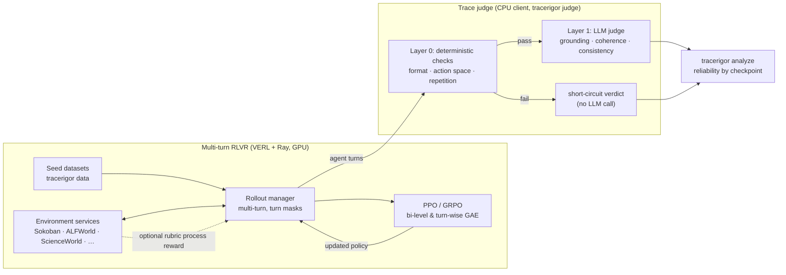

# TraceRigor

[](https://github.com/LukasWill/tracerigor/actions/workflows/ci.yml)

[](LICENSE)

Code for **[RLVR Makes Agents Win More, but Not Necessarily Reason Better](https://openreview.net/forum?id=jsTJu11CIh)**
(Lu, Lee, Spisak, Zhao, Wermter), presented at the NeurIPS 2026
[Workshop on Interpreting Agent Behavior](https://openreview.net/forum?id=jsTJu11CIh) and the
[Workshop on Evaluation of Interactive Agents](https://openreview.net/forum?id=xpTzSAVfAF).

**When reinforcement learning makes an agent succeed more often, does its reasoning get better, or does it just win?**

TraceRigor is a research toolkit for training multi-turn LLM/VLM agents with
reinforcement learning from verifiable rewards (RLVR), and for auditing whether
their visible reasoning traces stay reliable along the way. It treats trace
reliability as a measured quantity next to environment reward, because a
high-reward trajectory can still describe a state that isn't there, take an
action its own reasoning argues against, or ignore what the last turn revealed.

Each agent turn is scored on three rubrics:

| Rubric | Question asked of each turn |
| --- | --- |
| **Observation grounding** | Do the reasoning's claims about the current state match the observation? |
| **Action coherence** | Does the chosen action follow from the stated reasoning? |
| **Temporal consistency** | Does the reasoning update its beliefs after feedback from earlier turns? |

## Highlights

- **Multi-fidelity trace judge.** Deterministic Layer-0 checks (format,
  out-of-action-space, repetition, empty reasoning) resolve mechanically
  detectable failures *before* any LLM call. Only the remaining turns go to a
  Layer-1 LLM judge on any OpenAI-compatible endpoint (vLLM, OpenAI, Together,
  OpenRouter), with JSON-schema guided decoding, rate limiting, retries, and
  sampled audit logs of low-confidence verdicts
  ([`tracerigor/judge/`](tracerigor/judge/)).
- **Environment-aware prompts with ground truth.** Sokoban prompts include
  simulator-derived spatial relations, and ScienceWorld prompts encode the
  game's observation types, so the judge checks claims against state rather
  than plausibility. Non-LLM ScienceWorld checks and trajectory replay provide
  ground truth for validating the judge itself
  ([`tracerigor/verifier/`](tracerigor/verifier/)).
- **Multi-turn RLVR stack.** Service-backed environments, a multi-turn rollout
  manager with turn-level loss/GAE masks, and PPO/GRPO with `bi_level_gae`,
  `turn_wise_gae`, and `masked_gae` advantage estimators for turn-level credit
  assignment. Optional rubric-based process rewards can shape training, with
  bounded mapping, gating, and annealing schedules.
- **Nine environment integrations.** Sokoban, FrozenLake, and Blackjack run on
  CPU from `pip`; ALFWorld, ScienceWorld, BabyAI-Text, AI2-THOR Navigation,
  ManiSkill PrimitiveSkill, and SVG reconstruction are opt-in. Missing
  dependencies are isolated per environment and reported by `tracerigor envs`.
- **Reliability analysis.** `tracerigor analyze` summarizes judged JSON/JSONL
  records by checkpoint or any other field: rubric pass/uncertain rates, mean
  trace reliability, parse and query success, and heuristic short-circuit rate.



## Quick start (CPU, about two minutes)

Requires Python 3.10 or 3.11. No GPU, model weights, or API key needed.

```bash
git clone https://github.com/LukasWill/tracerigor.git
cd tracerigor
python -m venv .venv && source .venv/bin/activate
python -m pip install -e '.[envs]'
```

**1. Run the judge's deterministic layer on example turns.**
[`examples/judge/sample_turns.jsonl`](examples/judge/sample_turns.jsonl)
contains six Sokoban turns. The observations come from the seeded simulator,
and the agent responses are hand-written to show distinct failure modes.

```bash
tracerigor judge examples/judge/sample_turns.jsonl --dry-run --show-prompt -o routed.jsonl
# 6 turns: 2 short-circuited by heuristics, 4 would be sent to the LLM judge (dry run, no requests made)
```

| Turn | Failure mode | Route |
| --- | --- | --- |
| `invalid_action` | `Jump` is outside the action space | Layer 0, rejected without an LLM call |
| `format_violation` | no parseable action | Layer 0, rejected without an LLM call |
| `hallucinated_state` | reasoning misdescribes the grid | Layer 1 (grounding) |
| `incoherent_action` | pushes `Left` after planning to push right | Layer 1 (coherence) |
| `stale_belief` | claims last turn solved the puzzle | Layer 1 (temporal consistency) |
| `grounded` | consistent control case | Layer 1 |

`routed.jsonl` contains each turn's heuristic checks and the exact prompt the
LLM judge would receive, including the ground-truth spatial state.

**2. Judge them with an LLM.** Point the judge at any OpenAI-compatible server
(for example one started with [`scripts/launch_judge_server.sh`](scripts/launch_judge_server.sh))
or a hosted provider, then summarize:

```bash
python -m pip install -e '.[judge]'
tracerigor judge examples/judge/sample_turns.jsonl \
  --base-url http://127.0.0.1:8001/v1 --model <served-model-name> -o judged.jsonl
# hosted provider: --base-url https://api.openai.com/v1 --model <model> --api-key-env OPENAI_API_KEY
tracerigor analyze judged.jsonl
```

Verdicts depend on the judge model you choose. CI checks this path end to end
against a local stub endpoint. If a provider rejects JSON-schema decoding, add
`--no-structured-output`.

**3. Step an environment directly.**

```python
from tracerigor.env import get_environment

spec = get_environment("sokoban")
env = spec["env_cls"](spec["config_cls"](render_mode="text"))
obs, info = env.reset(seed=7)
print(obs["obs_str"])
obs, reward, done, info = env.step("<think>The box is to my right.</think><action>Right</action>")
print(reward, info["metrics"]["turn_metrics"])  # 0.4 {'action_is_valid': True, 'action_is_effective': True}
```

## Workflows and requirements

| Workflow | Command | Compute | Install |
| --- | --- | --- | --- |
| Analyze judged records | `tracerigor analyze` | CPU | base |
| Heuristic routing and prompt inspection | `tracerigor judge --dry-run` | CPU | base |
| LLM judging | `tracerigor judge` | CPU client + an endpoint | `.[judge]` |
| Inspect environments | `tracerigor envs --verbose` | CPU | `.[envs]` |
| Generate seed datasets | `tracerigor data` | CPU (Blackjack example) | `.[data,envs]` |
| Self-hosted judge model | `scripts/launch_judge_server.sh` | GPU sized to the model | vLLM (separate env) |
| Multi-turn RL training | `tracerigor train` / `examples/train/run.sh` | One or more CUDA GPUs | `.[train]` + external VERL |

There is no single VRAM figure: requirements follow from model size,
precision, context length, batch size, and sharding. See
[Installation and workflows](docs/run-exp.md) for details on each workflow and
[The trace judge](docs/judge.md) for the input schema, configuration, Python
API, and reward mapping.

### Seed datasets

```bash
python -m pip install -e '.[data,envs]'
tracerigor data examples/data/blackjack.yaml \
  --train-path data/blackjack/train.parquet \
  --test-path data/blackjack/test.parquet
```

### Training

Training needs a compatible VERL installation, model weights, and GPUs. It is
not a zero-compute quick start. The launcher checks its required variables and
defaults to a two-step smoke configuration with console-only logging:

```bash
export MODEL_PATH=Qwen/Qwen2.5-VL-3B-Instruct
export TRAIN_FILE=data/blackjack/train.parquet
export VAL_FILE=data/blackjack/test.parquet
bash examples/train/run.sh
```

> [!NOTE]
> VERL is an external dependency and its version is not yet pinned in this
> release. TraceRigor inherits its trainer from
> [VAGEN](https://github.com/RAGEN-AI/VAGEN), which vendors VERL as a git
> submodule. Use a VERL revision whose API matches `tracerigor/trainer/`
> (`verl.workers.fsdp_workers`, `verl.workers.reward_manager`,
> `verl.utils.dataset.rl_dataset`). See [Known issues](docs/known-issues.md).

## Where to look in the code

| If you want to see… | Start here |
| --- | --- |
| Layer-0/Layer-1 routing, response parsing, confidence | [`judge/router.py`](tracerigor/judge/router.py), [`judge/heuristics.py`](tracerigor/judge/heuristics.py) |
| Async provider client (rate limits, retries, event-loop handling) | [`judge/client.py`](tracerigor/judge/client.py) |
| Rubric scores → bounded process reward | [`judge/reward.py`](tracerigor/judge/reward.py) |
| Environment-specific judge prompts | [`judge/env_templates.py`](tracerigor/judge/env_templates.py), [`verifier/prompt/`](tracerigor/verifier/prompt/) |
| Mechanical ScienceWorld checks and replay | [`verifier/verifier/sciworld_mechanical_checks.py`](tracerigor/verifier/verifier/sciworld_mechanical_checks.py), [`sciworld_trajectory_replay.py`](tracerigor/verifier/verifier/sciworld_trajectory_replay.py) |
| Turn-level credit assignment | `compute_advantage` in [`trainer/ppo/ray_trainer.py`](tracerigor/trainer/ppo/ray_trainer.py) |
| Multi-turn rollout and masks | [`rollout/qwen_rollout/`](tracerigor/rollout/qwen_rollout/), [`rollout/utils/`](tracerigor/rollout/utils/) |
| A compact environment implementation | [`env/blackjack/`](tracerigor/env/blackjack/), [`env/sokoban/`](tracerigor/env/sokoban/) |

```text
tracerigor/
  analysis/   schema-tolerant reliability summaries (tracerigor analyze)
  judge/      typed packets, heuristics, router, client, reward, audit, batch CLI
  verifier/   environment prompts, parsers, mechanical checks, verifier clients
  env/        environment + service registry and nine integrations
  rollout/    service-backed multi-turn rollout managers
  trainer/    Hydra/VERL PPO entry point and advantage estimators
  inference/  provider adapters for evaluation rollouts
  server/     legacy environment and judge servers
examples/     judge, analysis, dataset, and training examples
docs/         workflow, configuration, judge, and environment guides
```

## Reproducibility scope

This repository is the software release accompanying the paper. It contains
the implementation, prompt definitions, public configuration, and small
fixtures. It does not contain raw experiment runs, model checkpoints, judge
outputs from the original experiments, research notebooks, manuscript sources,
or third-party datasets, so the paper's numbers cannot be regenerated from it
alone. Everything in the
quick start is reproducible on CPU and runs in CI. Open issues that affect
reproducibility are tracked in [docs/known-issues.md](docs/known-issues.md).

## Relationship to VAGEN and VERL

TraceRigor is derived from [VAGEN](https://github.com/RAGEN-AI/VAGEN) and keeps
substantial environment, rollout, and training infrastructure from it.
TraceRigor adds the trace-reliability judge and verifier layer, environment
ground-truth prompts and mechanical checks, violation tracking, RLVR-oriented
reliability analysis, additional environment integrations, and the
consolidated CLI. VERL and the simulators remain external dependencies under
their own licences.

## Citation

If you use TraceRigor, please cite the paper. It appears at two NeurIPS 2026
workshops; cite the venue you refer to. Both entries share the key
`lu2026rlvr`, so rename one if you include both in the same `.bib` file.

```bibtex
@inproceedings{
lu2026rlvr,
title={{RLVR} Makes Agents Win More, but Not Necessarily Reason Better},
author={Wenhao Lu and Jae Hee Lee and Josua Spisak and Xufeng Zhao and Stefan Wermter},
booktitle={The 1st Workshop on Interpreting Agent Behavior (IAB) at NeurIPS 2026},
year={2026},
url={https://openreview.net/forum?id=jsTJu11CIh}
}
```

```bibtex
@inproceedings{
lu2026rlvr,
title={{RLVR} Makes Agents Win More, but Not Necessarily Reason Better},
author={Wenhao Lu and Jae Hee Lee and Josua Spisak and Xufeng Zhao and Stefan Wermter},
booktitle={Workshop on Evaluation of Interactive Agents @ NeurIPS 2026},
year={2026},
url={https://openreview.net/forum?id=xpTzSAVfAF}
}
```

GitHub's "Cite this repository" button uses [`CITATION.cff`](CITATION.cff).

## Licence

Except where individual files state otherwise, TraceRigor is distributed under
the MIT License in [`LICENSE`](LICENSE), which retains the upstream VAGEN
copyright notice. Four retained files are under Apache License 2.0; see
[`THIRD_PARTY_NOTICES.md`](THIRD_PARTY_NOTICES.md) and
[`LICENSES/Apache-2.0.txt`](LICENSES/Apache-2.0.txt). Optional dependencies,
datasets, and models keep their own terms.

Contributions are welcome; see [CONTRIBUTING.md](CONTRIBUTING.md).
