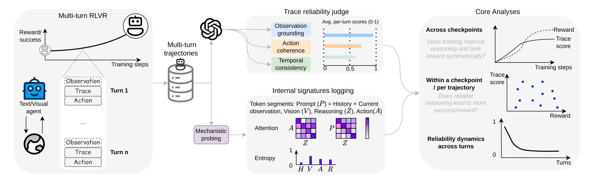
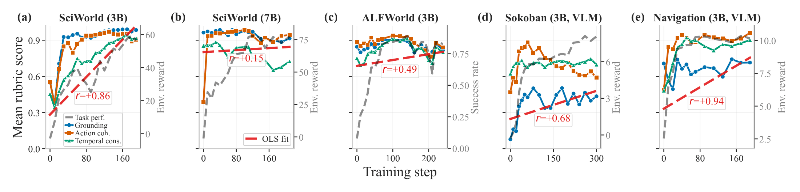
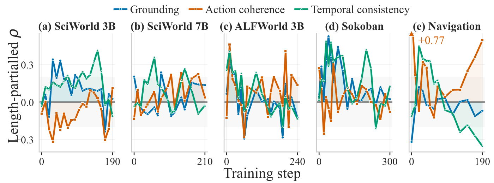
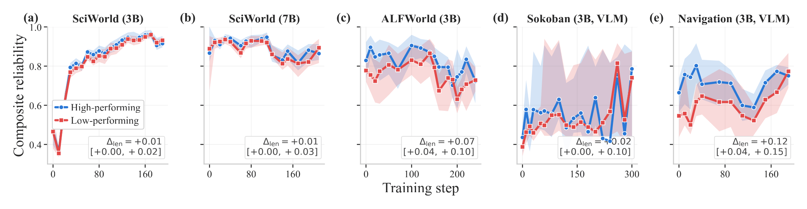
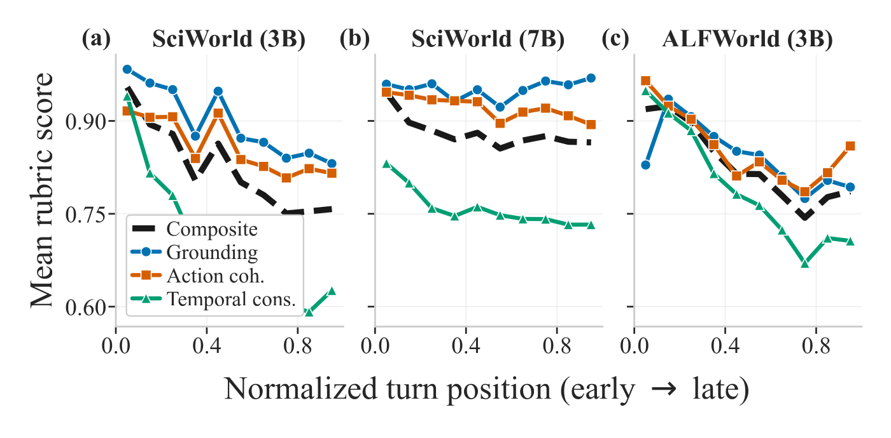
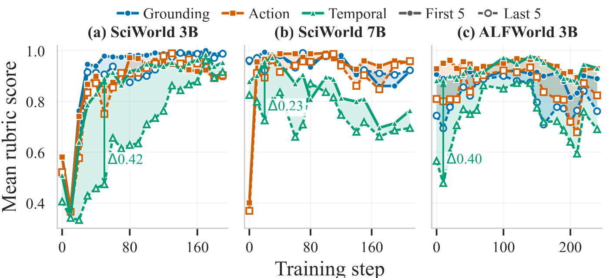
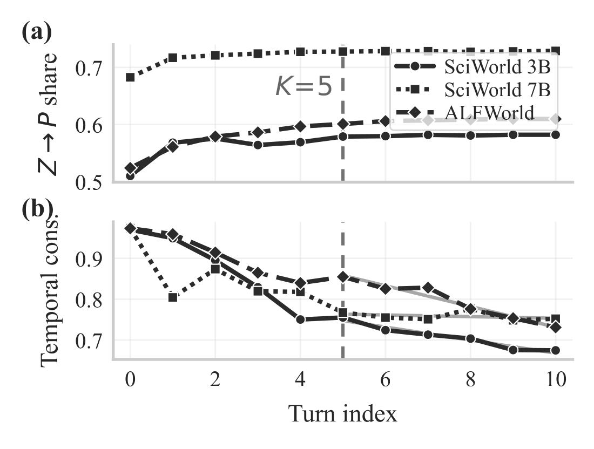
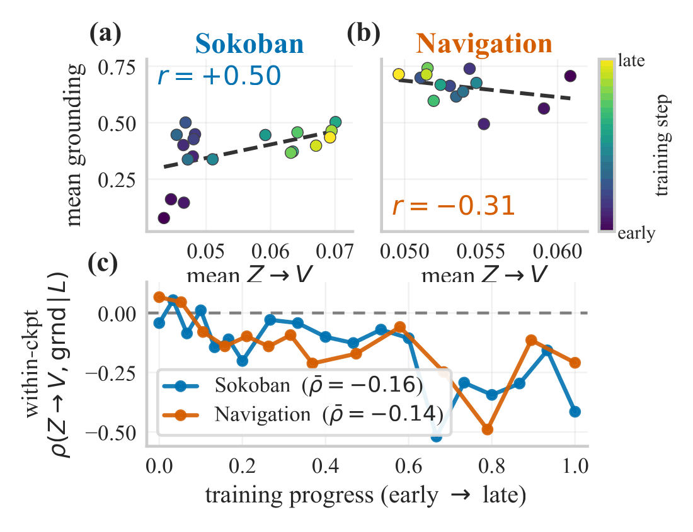
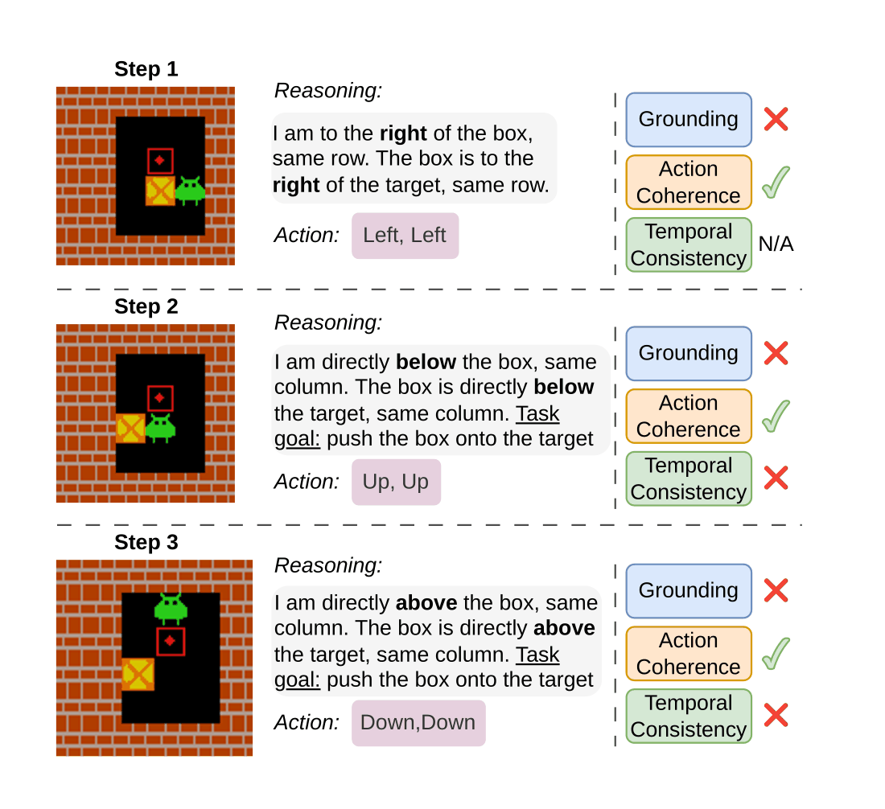

# Paper results

Results from **[RLVR Makes Agents Win More, but Not Necessarily Reason Better](https://openreview.net/forum?id=jsTJu11CIh)**
(Wenhao Lu, Jae Hee Lee, Josua Spisak, Xufeng Zhao, Stefan Wermter; NeurIPS 2026
Workshop on Interpreting Agent Behavior and
[Workshop on Evaluation of Interactive Agents](https://openreview.net/forum?id=xpTzSAVfAF)).
Figures, tables, and numbers are reproduced from the paper. Refer to the paper
for full methodology, statistical controls, and appendix analyses.



*At each evaluated checkpoint, multi-turn trajectories are collected, task
outcomes logged, each response parsed into a visible trace and an executable
action, and every judged turn labelled for grounding, action coherence, and
temporal consistency.*

## Setup

Five agents are trained with a PPO-based multi-turn RLVR framework with
turn-aware credit assignment, using environment-provided verifiable rewards.
The reliability judge is applied only post hoc and is not part of the RL
objective. Agent responses follow the ReflAct scaffold (reflect on the current
state relative to the goal, then act). ALFWorld, Sokoban, and Navigation denote
3B agents; only ScienceWorld is trained at two scales.

| Agent | Backbone | Performance signal | Mini-batch | Tokens (prompt / response / trajectory) | Turn cap | Rollouts | Judged |
| --- | --- | --- | --- | --- | --- | --- | --- |
| SciWorld-3B | Qwen2.5-3B-Instruct | reward | 16 | 2048 / 512 / 15000 | 30 | 128 | 128 / 64† |
| SciWorld-7B | Qwen2.5-7B-Instruct | reward | 8 | 2048 / 512 / 18000 | 30 | 128 | 64 |
| ALFWorld | Qwen2.5-3B-Instruct | success | 32 | 2048 / 512 / 18000 | 30 | 128 | 64 |
| Sokoban | Qwen2.5-VL-3B-Instruct | reward | 32 | 1024 / 200 / 2400 | 5 | 128 | 64 |
| Navigation | Qwen2.5-VL-3B-Instruct | reward | 32 | 1024 / 256 / 5000 | 5 | 128 | 64 |

† All 128 SciWorld-3B rollouts are judged at steps 0–70 and 64 of them at
steps 80–190. "Rollouts" is the number of evaluation trajectories per
checkpoint; "Judged" is the subset submitted to the reliability judge.

## Run configuration

Settings shared by all five agents:

| Setting | Value |
| --- | --- |
| Algorithm | PPO (actor–critic), [verl-tracerigor](https://github.com/LukasWill/verl-tracerigor) at tag `tracerigor-neurips2026` |
| Policy loss | asymmetric clipping ε_low = 0.2, ε_high = 0.28, dual-clip c = 3.0 |
| Advantage estimator | bi-level GAE: token-level GAE within a turn, turn-level return across turns |
| Turn-level discount | 0.95 |
| Actor / critic learning rate | 1e-6 / 1e-5 |
| Environment instances per step | 128 |
| Trajectories per instance | 1 |
| Rollout sampling | temperature 0.7, top-p 0.95 |
| KL control | reward channel, coefficient 0.001 (no actor KL loss) |
| Interaction window | K = 5 previous turns |
| Format reward | +0.5 per well-formatted turn |
| Training budget | 300 PPO steps |

Loss and advantage masks restrict updates to model-generated tokens.
Checkpoints are evaluated post hoc on a fixed grid of training steps.

Reliability judge:

| Setting | Value |
| --- | --- |
| Judge model | `gpt-5.4-nano-2026-03-17` |
| Max output tokens | 400 |
| Retries / timeout | 2 retries / 30 s per request |
| Output format | strict JSON; one `{yes_no, evidence}` entry per rubric |
| Malformed output | flagged as a parse failure and excluded from scoring |
| First-turn temporal rule | trivially YES (no history yet); excluded from temporal analyses where noted |

The shipped verifier configuration defaults to a different judge model; set
the model name explicitly to match the paper.

## 1. Performance and reliability co-evolve across training



*Per-checkpoint mean rubric scores (solid, left axis) overlaid with task
performance (dashed grey, right axis) for all five agents. Dashed red: OLS fits
of the cross-checkpoint association with composite reliability (mean of the
three rubrics), Pearson r annotated.*

Task performance improves substantially: mean cumulative reward rises from
−8.0 to +60.5 for SciWorld-3B, and ALFWorld success from 8.6% to 85.2%. Trace
reliability also tends to improve, but non-monotonically: rubric scores
typically rise early, then plateau, erode, or partially recover. The weakest
rubric differs by modality: temporal consistency in long-horizon text agents,
grounding in visual agents.

## 2. Within a checkpoint, performance and reliability are nearly decoupled

Trajectory length confounds the raw association: failed trajectories run to
the turn cap, and longer trajectories are judged less reliable. Controlling
for length collapses the apparent couplings.

Mean within-checkpoint Spearman correlation between task performance and each
rubric, after length control (raw value in parentheses). The last column is the
correlation between log trajectory length and performance.

| Agent | Grounding | Action coherence | Temporal consistency | ρ(log(1+L), G) |
| --- | --- | --- | --- | --- |
| SciWorld-3B | +0.10 (+0.17) | −0.09 (+0.02) | **+0.15** (+0.22) | −0.01 |
| SciWorld-7B | +0.02 (+0.02) | +0.05 (+0.22) | +0.07 (+0.13) | −0.25 |
| ALFWorld-3B | +0.01 (+0.16) | +0.08 (+0.40) | +0.05 (+0.34) | −0.68 |
| Sokoban-3B (VLM) | **+0.15** (+0.45) | +0.03 (+0.08) | +0.05 (−0.03) | −0.61 |
| Navigation-3B (VLM) | −0.04 (−0.08) | **+0.20** (−0.01) | +0.03 (−0.10) | +0.11 |



*Weak performance–reliability couplings vary across checkpoints. Each point is
the partial Spearman ρ between task performance and each rubric mean,
controlling for trajectory length.*



*Trajectories are split within each checkpoint into high- (blue) and
low-performance (red) groups (success for ALFWorld; median score otherwise).
Solid: length-controlled composite reliability; ribbons: 95% CIs; band: their
gap, with the pooled Δ_len and its 95% interval.*

The high–low composite gap is a small positive value (≈0.1 on a 0–1 scale).
The two reliability distributions overlap by 49–82%; for a random high–low
pair, the high performer is more reliable only 55–70% of the time (50% is
chance). For almost all agents, 83–100% of low-performing trajectories still
reach a composite reliability of at least 0.5.

## 3. Reliability degrades across turns



*Per-rubric reliability profile against normalised turn position for
long-horizon text agents, averaged over all trajectories and checkpoints.*

Reliability is front-loaded. Temporal consistency leads the decline in
long-horizon text agents, with the strongest decline in ALFWorld (mean
within-trajectory ρ = −0.27); no single rubric clearly leads for SciWorld-7B.
In visual agents the decline follows task-specific local failures: Sokoban is
grounding-led (−0.18) and Navigation action-coherence-led (−0.21).



*Mean rubric scores over the first five (solid) and last five (dashed)
evaluated turns of each trajectory; ribbons show the corresponding gaps.*

Early-turn reliability rises quickly or starts high and stays comparatively
stable, while late turns lag and change more over training. Temporal
consistency shows the largest early–late gap, peaking at Δ = +0.42 for
SciWorld-3B at step 50. The gap often narrows as agents master the task and can
widen again when performance regresses.

## 4. Mechanistic correlates



*Attention saturates but reliability keeps falling. (a) Trace-to-prompt
attention (Z→P) plateaus once the K = 5 window fills (dashed).
(b) Temporal consistency keeps declining past it (grey: OLS fits).*



*Rising vision attention does not certify grounded reasoning. (a, b)
Checkpoint-mean Z→V attention vs grounding, one point per checkpoint coloured
by training step. (c) Length-partialled within-checkpoint ρ(Z→V, grounding | L)
against training progress: about zero initially, becoming more negative with
training.*

Entropy and attention allocation shift broadly over training but rarely
distinguish more- from less-reliable traces. In Sokoban, trace-to-vision
attention (Z→V) correlates positively with grounding across checkpoints
(r ≈ +0.50), but the association reverses within checkpoints after length
control (mean ρ ≈ −0.16); in Navigation both views are negative.

## 5. Qualitative trace audits



*Example Sokoban turns in which actions remain coherent with false or revised
spatial premises that conflict with the board state.*

Across 34,436 judged text-agent turns and 3,524 judged visual-agent turns, the
most common pattern is acting on state claims that are unsupported, stale, or
contradicted by recent feedback. In ScienceWorld, 25.2% of judged turns contain
unsupported progress or outcome claims and 20.1% repeat failures without
adapting the plan. In Sokoban, 56.9% follow a false premise coherently and
72.6% reverse a player/box/target relation relative to the image. Three
families recur: false premises, stale premises after failed actions, and
premise adjustment that preserves local coherence without reliable state
tracking.

## Judge validation

Judge labels compared with independent human annotations on a stratified
sample of judged turns. N: doubly-labelled turns; Agr.: raw agreement;
κ: Cohen's kappa; Pos.: human positive rate.

| Setting | Rubric | N | Agr. | κ | Pos. |
| --- | --- | --- | --- | --- | --- |
| SciWorld / LLM | Grounding | 201 | 0.99 | 0.83 | 0.95 |
| | Action coherence | 201 | 0.82 | 0.42 | 0.74 |
| | Temporal consistency | 201 | 0.88 | 0.67 | 0.75 |
| ALFWorld / LLM | Grounding | 135 | 1.00 | 1.00 | 0.96 |
| | Action coherence | 135 | 1.00 | 1.00 | 0.95 |
| | Temporal consistency | 135 | 0.91 | 0.82 | 0.82 |
| Sokoban / VLM | Grounding | 84 | 0.96 | 0.80 | 0.10 |
| | Action coherence | 84 | 0.79 | 0.57 | 0.62 |
| | Temporal consistency | 84 | 0.88 | 0.76 | 0.37 |
| Navigation / VLM | Grounding | 45 | 0.84 | 0.65 | 0.71 |
| | Action coherence | 45 | 0.96 | 0.86 | 0.82 |
| | Temporal consistency | 45 | 0.89 | 0.75 | 0.67 |

Raw agreement is at least 0.79 in every cell. The lowest κ (SciWorld action
coherence, 0.42) reflects class imbalance rather than low raw agreement. Sokoban
grounding reaches κ = 0.80 at a human positive rate of only 0.10, so the high
visual grounding-failure rates are corroborated on the minority class.

## Citation

```bibtex
@inproceedings{
lu2026rlvr,
title={{RLVR} Makes Agents Win More, but Not Necessarily Reason Better},
author={Wenhao Lu and Jae Hee Lee and Josua Spisak and Xufeng Zhao and Stefan Wermter},
booktitle={The 1st Workshop on Interpreting Agent Behavior (IAB) at NeurIPS 2026},
year={2026},
url={https://openreview.net/forum?id=jsTJu11CIh}
}
```

The paper also appears at the
[Workshop on Evaluation of Interactive Agents](https://openreview.net/forum?id=xpTzSAVfAF);
see the [README](https://github.com/LukasWill/tracerigor#citation) for that entry.
